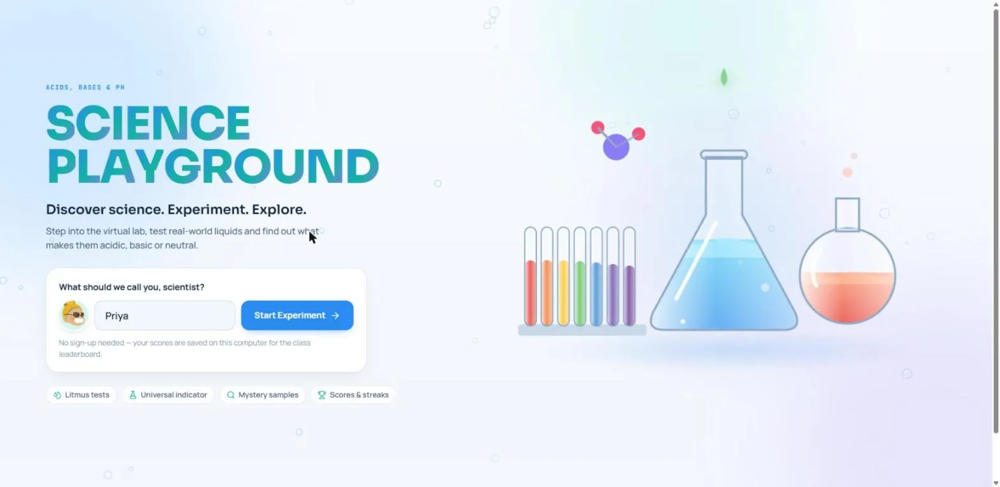
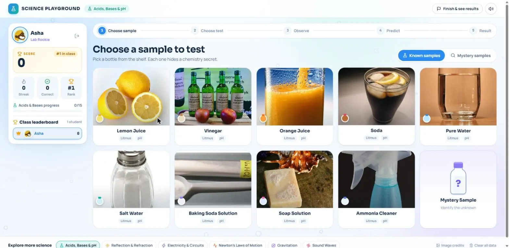
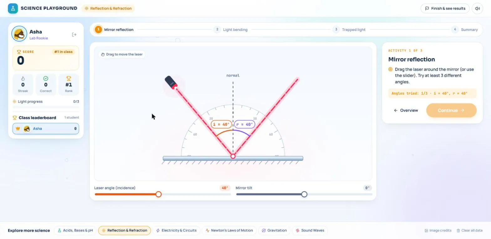
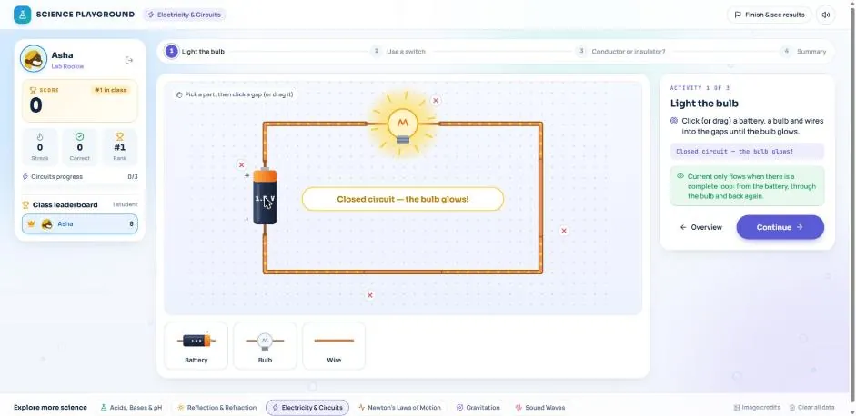
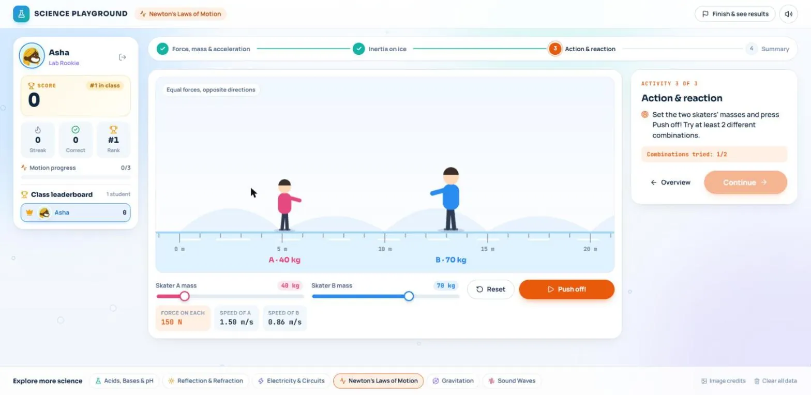
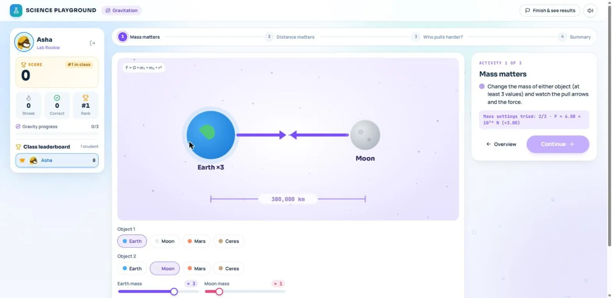
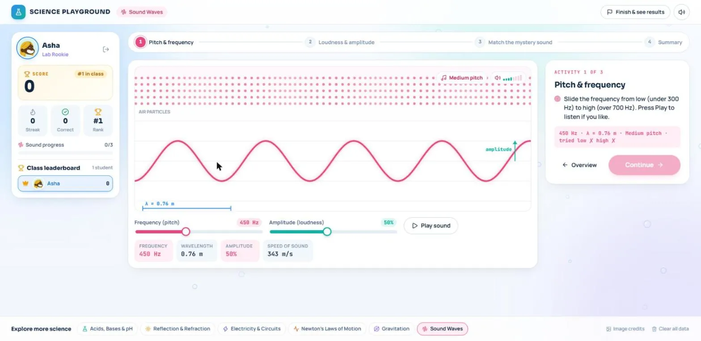

# Science Playground

An interactive virtual science lab for secondary-school students.

- **Acids, Bases & pH** is the main experience (default route `/`).
- Five physics labs are linked from the footer:
  - Reflection & Refraction (`#/optics`)
  - Electricity & Circuits (`#/circuits`)
  - Newton's Laws of Motion (`#/motion`)
  - Gravitation (`#/gravity`)
  - Sound Waves (`#/sound`)

It is frontend only (React 19 + TypeScript + Vite). There is no backend, login or database. Student profiles and the class leaderboard are saved in `localStorage`, so they are **shared by everyone using the same browser on the same computer** and are not synced between devices.



## Run

```bash
npm install
npm run dev      # http://localhost:5173
npm run build    # type-check + production build into dist/
npm run lint     # oxlint
```

## Student flow

Every topic follows the same simple pattern: enter a name, read one instruction, experiment, observe, answer one question per screen, get feedback and points, then continue. A stepper shows where you are. The scoreboard and class leaderboard stay visible in the sidebar, and become a compact bar on small screens.

| Acids, Bases & pH | Reflection & Refraction |
|---|---|
|  |  |
| **Electricity & Circuits** | **Newton's Laws** |
|  |  |
| **Gravitation** | **Sound Waves** |
|  |  |

## Classroom features

- **Profiles:** entering the same name continues that student's profile. Each student gets a DiceBear avatar, generated locally from the name.
- **Leaderboard:** shows the top 10, sorted by score. Ties go to whoever reached the score first. Rows animate when students overtake each other, and toasts plus confetti celebrate moving into the top 3.
- **No farming:** each challenge scores once per run. "Play again" starts a new run, while the leaderboard keeps each student's best run.
- **Clear all data** (in the footer, with a confirmation dialog) deletes every profile, score and piece of progress on this browser. The sound setting is kept.

## Where things live

| Area | Files |
|---|---|
| Classroom store (profiles, runs, leaderboard) | `src/state/session.tsx` |
| Topic registry (all six topics, lazy pages) | `src/topics/registry.ts` |
| Shared physics flow (intro → explore → question → feedback → summary) | `src/topics/TopicFlow.tsx` |
| Physics topics: content + simulations | `src/topics/{optics,circuits,motion,gravity,sound}/` |
| Acids & bases data, chemistry, scoring | `src/data/`, `src/lib/chemistry.ts`, `src/lib/scoring.ts` |
| Acids & bases flow | `src/components/flow/` |
| Lab building blocks (beaker, pH scale, molecules, sidebar) | `src/components/lab/` |
| Leaderboard + rank toasts | `src/components/classroom/` |
| Sample photos + credits | `public/images/samples/`, `src/data/imageCredits.ts` |

## Credits

Sample photos come from Wikimedia Commons under free licences (public domain, CC BY, CC BY-SA); see **Image credits** in the app footer. Chemical reactions and colours are driven by the scientific data, not by the photos. pH values are typical approximations.
